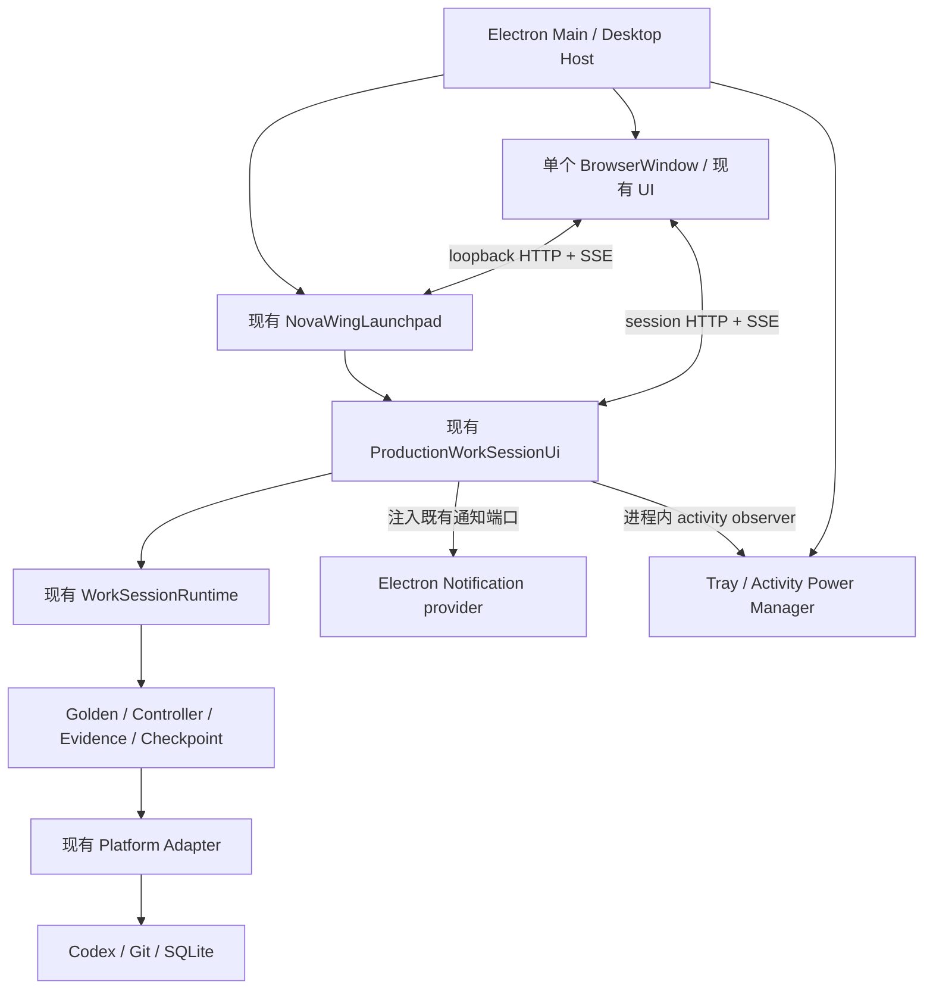

# NovaWing v0.4.0 Desktop Architecture Survey

> 代码目录：Windows `D:/VSCode/nova-wing`；macOS `/Users/weijianjun/nova-wing`。下列源码链接采用仓库相对路径，两个系统及 GitHub 均可导航。原始报告中的运行环境、实际执行结果不因链接改写而变成跨平台认证。

日期：2026-09-20

勘察基线：a9936908e242c1588154a558c5aa60b283b87171

当前分支：feat/v0.4-desktop；勘察开始时与 main 指向同一 HEAD，工作区干净。

**建议采用：Electron Main → 现有 Launchpad / Production Work Session 工厂 → 现有 Runtime；单个 BrowserWindow 加载现有 loopback HTTP UI。保留 HTTP/API/SSE，第一阶段不需要 preload 或业务 IPC。**

本报告是架构勘察和后续实施计划，尚未实现 Desktop。已阅读源码、相关测试、现行项目文档及协作规则；项目没有 CLAUDE.md。未安装依赖、未启动用户 Runtime、未执行真实 Codex task、未打开用户数据库、未 commit/push，也未改动 main。文中“建议新增/修改”均指后续工作。

用户给定的 v0.3.2 验收基线为 Windows/macOS real-host PASS、npm run check 970/970 PASS、reliability:v030 10/10 COMPLETED / COMMITTED。本次未重跑这些命令。仓库的历史跨平台报告仍留有 Windows NEEDS_WINDOWS_CONFIRMATION，不能把那份旧报告当成本轮 Electron 验收证据。当前实际环境为 PowerShell 7.6.5、Node v24.14.1、npm 11.11.0。产品阶段 v0.3.2/v0.4.0 与根 npm 包版本不同：当前 package.json 仍为 0.1.0。

## 1. Existing Architecture

当前仓库是一份根 npm 项目，packages 目录承载模块；package.json 没有 npm workspaces 声明。业务代码为 TypeScript / NodeNext ESM，build 仅由 tsc 编译。没有 React/Vite Renderer 工程，也没有 Electron 入口或桌面打包配置。

| 关注点 | 已核实的实现与证据 |
| --- | --- |
| CLI / Web 启动 | [guardian-launchpad.mjs](../../scripts/guardian-launchpad.mjs#L12) 创建 Launchpad、启动 HTTP、调用浏览器 app-mode opener；[guardian-work-session-ui.mjs](../../scripts/guardian-work-session-ui.mjs#L19) 从可信配置创建单个生产控制台。 |
| Launchpad | [launchpad/server.ts](../../packages/development-guardian/work-session/launchpad/server.ts#L476) 持有配置、liveApps、创建/启动去重及 scheduled recovery。它是现成的多 session 组合入口，不是一个纯静态页面。 |
| Control UI | [control-ui/server.ts](../../packages/development-guardian/work-session/control-ui/server.ts#L131) 提供 HTML、JS、CSS、status、控制 POST 和 SSE；[controller.ts](../../packages/development-guardian/work-session/control-ui/controller.ts#L218) 在服务端持有任务 Promise。 |
| 生产组合 | [production.ts](../../packages/development-guardian/work-session/production.ts#L572) 装配 executor/router、verification、Git、通知、controller、Runtime、HTTP server。 |
| Work Session | [runtime.ts](../../packages/development-guardian/work-session/runtime.ts#L427) 持有 Mastra workflow、持久化状态和相关 store；[model.ts](../../packages/development-guardian/work-session/model.ts#L16) 定义 READY / SCHEDULED / RUNNING / SUSPENDED / COMPLETED / FAILED / CANCELLED。 |
| Task 生命周期 | [task-state-v2.ts](../../packages/development-guardian/work-session/task-state-v2.ts#L44) 保存任务身份、权限、Git reality、验证计划与证据、恢复预算；[task-controller.ts](../../packages/development-guardian/work-session/task-controller.ts#L40) 作行动与完成判定。 |
| Golden Path | [golden-path.ts](../../packages/development-guardian/work-session/golden-path.ts#L30) 复用 dispatcher、独立 verifier、Evidence 与 finalizer；不满足条件转既有 V2 Controller。生产装配取决于可信配置，不能把历史 V1/非 Golden 配置强行转换。 |
| Evidence | [golden-path.ts](../../packages/development-guardian/work-session/golden-path.ts#L156) 校验 verifier step 身份与结果；[risk-evidence.ts](../../packages/development-guardian/work-session/risk-evidence.ts#L63) 校验 repository/branch/head/worktree 身份及确定性证据。 |
| Checkpoint | [checkpoint.ts](../../packages/development-guardian/work-session/checkpoint.ts#L40) 定义恢复身份；[git-checkpoint.ts](../../packages/development-guardian/work-session/git-checkpoint.ts#L510) 在确定性完成后执行受控 Git checkpoint，保持保护分支、scope、证据及显式 push policy。 |
| Platform Adapter | [platform/paths.ts](../../packages/development-guardian/platform/paths.ts#L11)、[shell.ts](../../packages/development-guardian/platform/shell.ts#L54)、[codex-runtime.ts](../../packages/development-guardian/platform/codex-runtime.ts#L27) 分别集中路径、shell、SDK native binary 解析。 |
| 通知 | [notifier.ts](../../packages/development-guardian/work-session/notifier.ts#L76) 已有 WorkSessionNotifier、kind、EMAIL/DESKTOP、渠道投递结果；当前 desktop factory 仍转向 Windows adapter。 |
| SQLite | Work Session 主库由 Mastra/libSQL 与 ScheduledStartStore 使用同一 driver；ledger、analytics、coding coordination 在独立库使用 node:sqlite。不是所有数据都由 packages/sqlite 的通用内核 store 持有。 |
| 测试和构建 | [package.json](../../package.json#L37) 的 check 串联 typecheck、Node tests、unused、migration、exports、boundaries、platform；test 先编译，之后 node --test 串行运行。 |

最重要的保留链路：

任务配置 → Work Session → Golden / Controller → Codex 或既有 executor → 独立 VERIFY → Evidence gate → Git checkpoint → durable terminal state → 原有通知队列。

Desktop 不另建 Task 状态机，不根据 Renderer 文案或 Codex 进程退出码自行判定 COMPLETED，也不绕过 checkpoint 判定。

## 2. Runtime Entry

### A. Main 如何复用

现有入口分为三个层级，不能混为一谈：

1. CLI Host：scripts/guardian-launchpad.mjs / guardian-work-session-ui.mjs。这里有顶层启动、浏览器打开、SIGINT/SIGTERM 处理，**不作为 Main 的 import 目标**。
2. 生产组合 API：createNovaWingLaunchpad() 与 createProductionWorkSessionUi()。已从本仓库的 nova-wing/development-guardian 出口导出，可直接 import。
3. Runtime：new WorkSessionRuntime(config)。可以 import，但直接使用会要求 Main 重做 production.ts 的装配；不建议以它作为产品启动入口。

createProductionWorkSessionUi() 返回 definition、runtime、controller、server、start、isLive、hasActiveSession、close。它先恢复持久化状态；返回对象的 start() 只启动控制 HTTP listener。真正任务执行由 controller.start() / runtime.start() 发起。[生产工厂与返回值](../../packages/development-guardian/work-session/production.ts#L938)

Launchpad 创建 session 时复用这个工厂，启动其控制 server，再调用 controller.start()。Main 持有一个 Launchpad Host；Launchpad 内部可以持有多个现有 WorkSessionRuntime 实例。**“一个 Host”不意味着复制一个全局 Runtime，更不意味着每个窗口创建一个 Runtime。** [创建链路](../../packages/development-guardian/work-session/launchpad/server.ts#L1104)

### 耦合点与必要 API

目前 Runtime 本体没有 Electron、BrowserWindow 或 HTTP server 类型依赖；production.ts 将 Runtime 与 controller/server 组合，这是可接受且可以直接复用的组合边界。

**首阶段不需要拆出新的 createRuntime/startRuntime 大接口。** 建议新增很薄的 createDesktopHost()，负责：

- 调用现有 createNovaWingLaunchpad，启用既有 production preflight。
- 利用既有 dependencies.createWorkSession 注入口调用同一个 createProductionWorkSessionUi。
- 保存宿主创建的控制 URL、session 身份、活动订阅和 shutdown promise。
- 注入 Electron notification provider，聚合活动数量。
- 提供 start()/shutdown() 及窗口导航所需的只读信息；不实现任务执行逻辑。

需要补的通用边界是 **严格可等待的 Host shutdown、精确 activity observer、桌面 notifier 注入**，不是重写 Runtime。

一个重要副作用：Launchpad.start() 会恢复 SCHEDULED 配置并开启后台到期检查，过期任务可能自动执行。因此 Desktop compatibility smoke 必须使用隔离空配置及临时数据目录，不能直接指向用户生产配置。[scheduled recovery](../../packages/development-guardian/work-session/launchpad/server.ts#L621)

## 3. UI Integration

### B. 当前 UI 的真实形态

[Launchpad view](../../packages/development-guardian/work-session/launchpad/view.ts#L81) 与 [Control view](../../packages/development-guardian/work-session/control-ui/view.ts#L756) 是服务器生成的 HTML + CSS + vanilla JS 字符串。不存在可直接接管的独立 frontend build。

- Launchpad 通过 HTTP 展示、创建、启动配置；页面定期拉取配置列表。
- Control UI 使用相对路径 fetch 和 EventSource('/api/events')；实时通道是 **SSE**，未发现这条产品链路使用 WebSocket。
- Launchpad 监听 127.0.0.1 随机端口；它创建的每个控制 server 也使用随机端口。
- 创建或打开 session 后，页面用 window.location.assign(result.controlUrl) 跳转到控制台。[页面跳转](../../packages/development-guardian/work-session/launchpad/view.ts#L313)

因此第一阶段应：

1. Main 启动 Launchpad，拿到实际 address.url。
2. 单窗口 loadURL(address.url)，原样消费 HTTP/API/SSE。
3. 保留两套 server、原 token、Host/Origin 校验、CSP 与相对请求。
4. 不复制 UI，不将 view.ts 输出改成 file:// 页面；后者会改变 Origin、bootstrap token 和 EventSource 假设。
5. 不强行把业务 HTTP 改成 IPC。没有新的 Renderer 特权需求时，**不创建 preload**。

导航需要一个很小但必要的 Desktop 集成点：Main 只允许自己启动的 Launchpad origin 及已登记的 session control origins，不能只允许第一个端口，也不能允许任意 localhost。URL 登记应在控制 server.start() 返回后、页面拿到 controlUrl 前完成；失效实例关闭后注销。Tray“显示窗口”恢复最后有效页面；单窗口菜单可提供“返回 Launchpad”，无需 UI 改版。

BrowserWindow 设置 nodeIntegration=false、contextIsolation=true、sandbox=true、webSecurity=true；阻止未登记导航和新窗口。现有 Host/Origin/token 校验不为 Desktop 放宽。未来如果增加原生文件选择，再单独添加窄 IPC；这不属于本轮最小方案。[Electron 安全建议](https://www.electronjs.org/docs/latest/tutorial/security)

## 4. Proposed Electron Architecture

建议目录如下，按步骤逐个增加，不预建一套前端工程：

    desktop/
      main/
        index.mjs          Electron app 入口、single instance
        host.mjs           现有 Launchpad 的薄宿主包装
        window.mjs         单窗口与受控 URL 导航
        shutdown.mjs       一次性异步退出协调
        tray.mjs           显示 / 隐藏 / Quit
        notifications.mjs  实现 WorkSessionNotifier
        power.mjs          active 集合与一个 blocker
        platform.mjs       必要的 Electron OS 外壳差异
      assets/              托盘与应用图标
      packaging.mjs        后续打包配置，首 commit 不加
      tests/               纯宿主单测与 Electron smoke 入口
    scripts/
      desktop-smoke.mjs    外部 Node 启动 smoke，检查退出及资源证据
      desktop-package.mjs  后续生成隔离 staging 并打包

采用 .mjs 是本报告对“小外壳、最小 diff”的建议，与现有宿主脚本一致；可用 JSDoc 引用已构建的类型。无需修改现有 TypeScript 编译边界。如团队后续选择 TS，可独立增加 tsconfig.desktop.json，不能把 Electron import 混入业务 packages。

开发时仍从仓库根包上下文 import nova-wing/development-guardian；暂不加一个改变 package scope 的 desktop/package.json。打包时生成独立 staging manifest，保留该 self-reference 所需的 name/exports、type="module"、production dependencies 及 dist/packages/... 相对布局，再设置 desktop main、产品名和 Desktop 版本。锁文件与目标平台 optional dependencies 的安装/复制必须一致；Desktop 内容不能直接套用 kernel npm 包的 files 白名单。

正式私有 npm kernel 包不含 development-guardian，也不携带这套生产依赖，因此不能直接拿现有 release-package 作为 Desktop 产品内容。[正式发布清单](../../scripts/release-lib.mjs#L75)

## 5. Runtime Lifecycle

### C. 关窗与后台执行

当前任务 Promise、scheduled timers、SQLite、child processes 都由 Node 服务端持有；UI/SSE 断开只移除订阅，不是取消任务。已有 SSE disconnect 测试覆盖 subscriber cleanup。[SSE 测试](../../tests/work-session-w005-a-sse.test.ts#L138)

Desktop 生命周期建议：

| 事件 | 行为 |
| --- | --- |
| app ready | 建立 Host、Tray、单窗口，启动 loopback service 后加载 UI。 |
| 普通窗口 close | preventDefault + hide；不调用 server.close、runtime.close 或 app.quit。 |
| 窗口意外销毁 / Renderer crash | Host 继续持有任务；用户再次打开时重建一个窗口并加载有效 URL。 |
| Tray 显示 / 通知点击 / macOS activate | 复用 showWindow：必要时重建、restore、show、focus。 |
| SCHEDULED idle | 保留 server 侧 scheduler；没有执行时不阻止睡眠。到期醒来后沿既有到期逻辑处理，不承诺休眠中唤醒机器。 |
| Quit / Cmd+Q / 开发重启 | 进入唯一 shutdown promise，禁止新操作，等待正常 drain，清理后才允许 app.quit。 |

应主动处理 window-all-closed，保持后台 app；不使用常见示例中“Windows 最后窗口关闭就 app.quit”的默认写法。before-quit 必须同步 preventDefault，再等待自己保存的 shutdown promise；完成标志置位后再次 app.quit，避免递归拦截。[Electron app 生命周期](https://www.electronjs.org/docs/latest/api/app)

### 现有 shutdown 的事实与缺口

WorkSessionRuntime.close() 已有正确的核心 drain 合约：

- 立刻关闭新操作接纳。
- 共享同一个 closeOperation。
- 等待已接纳的 start/resume/storage/verification/checkpoint/repair 操作与快照写入。
- 等待通知及 LibSQL 初始化，然后尝试关闭每一个自己拥有的 store。
- 汇总关闭错误。[runtime.close](../../packages/development-guardian/work-session/runtime.ts#L2506)

它**没有即时 abort Codex 的含义**，也不会自动 requestPause/stopAfterTask。在途 workflow 可能继续执行至 settle。MVP 的 Quit 应明确显示“正在等待任务安全结束”，采用现有 drain 语义；不添加固定 5 秒强制退出。若以后要“当前 Task 完成即退出”，必须另行定义 stop-after-task 的用户语义。

然而 **目前不能只写 await launchpad.close(); app.quit()**：

- [Launchpad.close](../../packages/development-guardian/work-session/launchpad/server.ts#L644) 分阶段 bounded 等待，默认每阶段 5 秒；allSettled 的错误被丢弃，然后清空 liveApps。
- 重入 close 仅检查 closed 后返回，不共享完成 Promise。
- activeDeletes 只有 Set；手动 repair、部分状态读取及启动中的异步 preflight 没有统一纳入 drain。
- Launchpad.start() 的异步恢复/preflight 与 close 竞态可能出现迟到 listener。
- [Production UI.close](../../packages/development-guardian/work-session/production.ts#L961) 先关闭 server；需要确保 server 关闭异常时仍能关闭 Runtime。
- [Control server.close](../../packages/development-guardian/work-session/control-ui/server.ts#L104) 在等待 HTTP 关闭后才 controller.close；应先禁止新控制操作和停调度，再排空已接纳工作，避免 shutdown 期间仍由 polling 接纳新任务。

建议在现有 Launchpad 内部增加明确的 strict drain 模式/出口，保留 CLI 默认兼容行为；Desktop 必须选择 strict 模式。具体改动限定为共享 start/close promise、接纳登记、停止新入口、排空已接纳的 start/create/delete/repair/status/schedule、收集全部关闭错误。所有实例均要尝试 cleanup；timeout 只能给出等待提示，不能表示 drain 成功。

关闭错误要在 Desktop 中可见，不能伪报成功，也不能在半关闭状态重新开放新任务。Windows shutdown/logout 不保证发出 Electron 常规 quit 事件，强杀也不属于 graceful shutdown；沿用既有 durable recovery，不能承诺这两种情况无损正常退出。[Electron 退出事件限制](https://www.electronjs.org/docs/latest/api/app)

## 6. Tray / Notification / Power Design

### D. Tray

- app ready 后创建一次 Tray，Main 保留强引用。
- 菜单仅“显示窗口”“隐藏窗口”“Quit NovaWing”；Tray 点击复用 showWindow。
- Quit 只调用统一退出协调器；drain 期间 Tray 保留，可展示等待状态。
- drain 与资源 cleanup 完成后才 destroy Tray 并结束 app。
- Windows 图标和 macOS template 图标放 desktop/assets，业务逻辑共用；资源解析不依赖 cwd。[Electron Tray](https://www.electronjs.org/docs/latest/api/tray)

### E. Native Notification

已有 WorkSessionNotifier 足够承载三种目标通知，不需要新事件总线或在 UI 里 new Notification。

当前存在两个实际缺口：

1. Windows task notifier 的 notificationKinds 只有 COMPLETED/FAILED，notifyHumanRequired 是 deliberate no-op。无 SMTP 时 HUMAN_REQUIRED 被能力筛选排除，不会入队。[现有 adapter](../../packages/development-guardian/platform/windows-task-run-notifier.ts#L54)
2. SMTP 存在但 notifyOnCompleted=false 时，production 当前不设置 terminalNotifier，Runtime 完成通知 guard 也会挡住 Desktop 完成通知。[production wiring](../../packages/development-guardian/work-session/production.ts#L578)、[完成 guard](../../packages/development-guardian/work-session/runtime.ts#L3110)

最小方案：

- 给 ProductionWorkSessionDependencies 增加显式 desktopNotifier 注入口；CLI 缺省仍使用原 adapter。
- Electron provider 实现 notificationChannel='DESKTOP'，明确支持 COMPLETED / FAILED / HUMAN_REQUIRED。
- 仅在显式注入 Electron provider 的 Desktop 分支，独立启用 terminalNotifier，并按 email.notifyOnCompleted 对 EMAIL 的完成投递能力作筛选；缺省 CLI 仍沿用原组合。**不能为启用 Desktop 而把 notifyOnCompleted 一律设 true，意外打开完成邮件。**
- notificationChannels、durable generation/attempt flags、原有单渠道有限重试和 notificationObserver 全部复用；不从 Renderer、SSE 或 polling 重复触发通知。
- 保留已有完成语义：成功完成通知对应 ALL_TASKS_COMPLETED；SOFT_LIMIT/MAX_TASKS/用户停止不冒充“任务全部完成”。FAILED 在失败状态落盘后投递；HUMAN_REQUIRED 对应 SUSPENDED + humanRequired，排除普通 USER_PAUSED。
- 不 backfill 历史完成记录，也不因窗口重开重复发；这沿用既有恢复/去重语义。

provider 将 native show/failed 事件转成现有 SENT/FAILED，用有限投递等待避免阻塞 Runtime.close。不能把 Notification.isSupported() 或调用 show() 当作“用户已看到/点击”。权限、系统免打扰和平台通知服务的实际行为仍需真机验收。[Electron Notification](https://www.electronjs.org/docs/latest/api/notification)

这里还有一个需避开的既有聚合语义：全渠道 SKIPPED 会被 overallNotificationStatus 归为 ALL_SUCCEEDED，Runtime 可能据此写入 SENT/notified。因此，若创建 provider 时已确认 native 不可用，应不登记该渠道或将 notificationKinds 设为空，避免入队；宿主能力诊断可显示 SKIPPED。已接纳投递后出现错误或无法确认投递，按 FAILED 与既有有限重试处理，不能用全 SKIPPED 冒充未成功投递。此方案不要求修改 Runtime 的公共聚合规则。[聚合逻辑](../../packages/development-guardian/work-session/notifier.ts#L133)

通知 click 的闭包只保存 sessionId；Main 从自己登记的 live URL 找到对应控制台，再 showWindow + focus，URL 失效则返回 Launchpad。不要执行通知 payload 中任意 URL。保留 Notification 对象及 click handler 到合适的生命周期，不能在 show 后立刻释放；Windows 初次消失后仍可能从通知中心点击。

另有 Launchpad RepairNotifier 与 RuntimeRepairNotifier，它们不等同这三类 Work Session 通知，且部分旧 repair notify 的异常会影响 repair 流程。MVP Desktop 可通过既有 seam 注入无外部投递的实现，保留 audit/UI；本阶段不扩展 repair toast 事件。CLI 行为保留。不要复用会抛错的 Windows toast 作为 Electron 原生通知回退。

Windows 要验证应用身份/开始菜单快捷方式；macOS 要在所选 Electron 版本下验证应用签名及通知事件。当前 Electron 官方文档明确提示 macOS 的通知事件依赖代码签名。不要把 development electron.exe 的通知成功等同于交付包成功。[通知平台要求](https://www.electronjs.org/docs/latest/tutorial/notifications)

### F. Prevent Sleep

使用 Main 的 powerSaveBlocker.start('prevent-app-suspension')，允许熄屏，避免任务执行时因自动休眠中断；不使用永久 blocker，不要求屏幕常亮。[powerSaveBlocker](https://www.electronjs.org/docs/latest/api/power-save-blocker)

最佳接点是 **进程内操作接纳/结束**，而非 Renderer 连接或 durable RUNNING：

- 已有 hasActiveSession() → controller.hasActiveOperation()，关注 start/resume/checkpointRecovery promise；repair/审批也使用对应操作 Promise。
- runtime.hasActiveExecution() 是曾执行过的 sticky 标志，不适合作 blocker 判断。
- 现有 UI subscribe 在 Promise 建立前发事件、finally 清除后没有精确广播，且 close 会清 subscriber，不能直接当可靠 activity observer。[controller activity](../../packages/development-guardian/work-session/control-ui/controller.ts#L192)

建议给 controller 加无 Electron 依赖的 activity observer，在接纳操作之前获得活动 lease，在 finally 释放。覆盖 start、due dispatch、resume、verification approval、runtime repair、checkpoint recovery；异常同样释放，observer 异常不能改变业务结果。

Host 用 session/operation 集合聚合，首次有活动 start blocker，最后一个结束 stop；重复事件幂等。Launchpad 前置 AI repair 若实际执行模型，也通过宿主操作登记纳入；纯浏览、状态读取和未来 SCHEDULED 等待不占 blocker。关闭窗口不释放；shutdown 期间只在实际有活动/drain 工作时保留，最后由 finally 兜底释放。

SUSPENDED HUMAN_REQUIRED、USER_PAUSED、terminal、未来 SCHEDULED 在无实际操作后释放。一个 session 结束时，另一个还在 VERIFY/checkpoint，不能提前释放。Main 退出协调持有 drain lease，避免 server 停订阅导致正在执行的任务失去 blocker。

## 7. Required File Changes

以下是后续实施的变更清单，不是本次已经修改的文件。

### 新增

| 文件 | 原因 / 时机 |
| --- | --- |
| desktop/main/index.mjs | Electron ESM 入口、ready、single instance、启动错误收口；首 commit。 |
| desktop/tests/runtime-compatibility.mjs | 在 Electron Main 中验证真实生产模块 import、node:sqlite/libSQL 和隔离 Runtime 生命周期；首 commit。 |
| scripts/desktop-smoke.mjs | 外部 Node 启动 smoke，校验退出码/有限等待/机器可读证据；首 commit。 |
| desktop/main/host.mjs、window.mjs、shutdown.mjs | 主进程拥有现有 Host、控制 URL 注册、单窗口、异步退出；接入阶段。 |
| desktop/main/tray.mjs、notifications.mjs、power.mjs、platform.mjs | 外壳能力与必要 OS 差异；分步增加。 |
| desktop/assets/* | Tray / application 图标，Windows 与 macOS 使用合适资源。 |
| desktop/tests/*.test.mjs、tests/desktop-host-lifecycle.test.ts | 纯宿主策略，以及现有 Launchpad strict drain/controller observer 的 Node 回归。 |
| desktop/packaging.mjs、scripts/desktop-package.mjs | 从既有 build 生成隔离 staging，携带生产依赖与 native 资源；兼容性门禁后才加入。 |

### 修改现有文件

| 文件 | 最小修改理由 |
| --- | --- |
| [package.json](../../package.json#L37) / package-lock.json | 后续固定 Electron 开发依赖和 desktop scripts；先不加 bundler/updater；不重写现有 build/test/发布版本语义。 |
| [launchpad/server.ts](../../packages/development-guardian/work-session/launchpad/server.ts#L644) | strict shutdown、start/close 幂等、已接纳操作登记、晚完成创建/repair 的关闭竞态；复用原 session 创建路径。 |
| [production.ts](../../packages/development-guardian/work-session/production.ts#L462) | 增加 desktop notifier/activity 注入，独立 email/Desktop completion 策略；健壮关闭；不复制 executor 装配。 |
| [control-ui/controller.ts](../../packages/development-guardian/work-session/control-ui/controller.ts#L192) | activity observer 和关闭时停止新接纳，保留现有 Task/Session 语义。 |
| [control-ui/server.ts](../../packages/development-guardian/work-session/control-ui/server.ts#L104) | 幂等关闭、先停新操作/调度再 drain，确保 SSE/HTTP 异常不跳过 cleanup。 |
| [check-platform-boundaries.mjs](../../scripts/check-platform-boundaries.mjs#L6) | 必要时仅登记 desktop/main/platform.mjs 等明确 adapter，不豁免整个 desktop。 |
| [check-boundaries.mjs](../../scripts/check-boundaries.mjs#L6) | 把 desktop 源码纳入静态扫描，防止新目录脱离检查。 |
| [README.md](../../README.md#L151) | Desktop dev/smoke/package 入口，关窗/退出区别与数据路径说明。 |
| notification-channel-status / production wiring / scheduled recovery / Launchpad tests | 添加带 Desktop provider 的新断言，保留原 CLI、legacy、SMTP opt-in 测试。 |

只在相应探针证明需要时修改：

- platform/codex-runtime.ts：真实 unpacked vendor 路径解析；保持 SDK 来源、target 映射和完整资源身份，不回退全局 Codex。
- platform/executables.ts 或新增 platform/git-runtime.ts：统一 Git executable/env 合约；将生产 Git、MCP Git、checkpoint Git、preflight 的解析结果对齐。
- platform/environment.ts / dependency-health.ts：有限 GUI 环境规范化、Electron 宿主能力与任务工具链的真实探测。
- platform/paths.ts / defaultTrustedConfigDirectory：统一绝对 override 规则；不能静默迁移现有数据。
- scripts/check-package-exports.mjs：仅当确实新增运行时导出时同步精确列表。优先使用既有出口与类型字段，避免扩大出口。

原则上不修改：

- packages/core、packages/host-snapshot、通用 packages/sqlite schema/migration/ownership。
- Golden Path、TaskController 的完成/路由规则、Evidence/verification gate、TaskStateV2。
- checkpoint 数据结构、Git finalizer 的 commit/push/scope/保护分支策略。
- WorkSessionRuntime 的业务状态机与 close drain 语义；本计划以 production/controller/Host seam 为主，若实现时确需 additive observer，只增观察能力。
- 两套 UI 的布局和业务 API；第一阶段不需要修改 view.ts。
- 既有 Windows/macOS Platform Adapter 业务契约，以及正式 npm kernel release 流程。

## 8. Implementation Steps

顺序以尽早暴露 Native/生命周期问题为准。每步完成后再进入下一步，不把全部内容塞进一个 commit。

| Step | 可执行范围 | 完成条件 |
| --- | --- | --- |
| 1 | 固定 Electron 版本；先 build 再显式启动 .mjs；空壳单窗口；隔离 Main compatibility smoke | Main 能 import 现有 Guardian；实际验证 node:sqlite、libSQL、临时 Runtime create/load/close/reopen；不读取真实配置。 |
| 2 | 补 Host strict drain 和 operation activity 边界 | Gate 控制的异步测试证明 close 不早退、不吞错、不产生迟到 listener/任务；旧 CLI 测试保留。 |
| 3 | Main 直接创建现有 Launchpad、加载原 UI | 现有创建/跳转/API/SSE 可用；Main PID 持有 Runtime，Renderer 重载不重建 Runtime；先用隔离测试 fixture。 |
| 4 | 关窗后台运行、单实例、重复启动/开发重启 | Hide/Renderer disconnect 不停止任务；Quit 等 drain；重开界面看到同一 session。 |
| 5 | 最小 Tray | 显示/隐藏/退出全部走统一 window/shutdown API。步骤 4 与 5 未完成前不作为日常后台版分发。 |
| 6 | 三类 Native Notification | 无 SMTP 也有三类通知；有 SMTP 时 completion opt-in 不变；click 定位 session；投递失败不影响任务。 |
| 7 | Power manager | 多 session 活动聚合；执行/VERIFY/checkpoint 保持 blocker，idle/suspend/terminal/错误/退出均无泄漏。 |
| 8 | 早期 packaged-directory smoke | 在源码仓库外运行 Windows .exe；核验 Node/SQLite/libSQL、完整 Codex vendor、Git/GUI PATH、可写目录、shutdown。不要等真实模型失败后才测 packaging。 |
| 9 | Windows real-host Codex task | 用 Electron UI 在临时非保护分支创建受控真实任务；关窗继续；独立 verifier、Evidence、checkpoint、通知点击、power、重开状态逐项取证。 |
| 10 | Windows 基础链路通过后立即 macOS 真机 | 先同样的 Main compatibility 与 .app 链路，再真实任务、Finder PATH、Dock/activate/Tray、通知签名与 click、power；不先扩展其他产品功能。 |
| 11 | 收尾可分发产物和回归 | Windows exe 所在完整目录/简单分发包；macOS .app/.dmg；原 check、Desktop smoke、选定 real-host 证据形成交付记录。 |

打包建议先使用 @electron/packager 生成平台目录；这足以得到带完整依赖的 Windows .exe 和 macOS .app。exe 不是可以脱离 resources 单独拷走的单文件产品。DMG 可在 macOS 链路通过后追加轻量产物步骤，不要求复杂安装向导。[Packager 官方说明](https://electron.github.io/packager/main/)

第一轮可明确设置 asar=false，先验证真实文件布局；本 MVP 没有必须启用 ASAR 的业务要求。若随后启用，原生 addon、Codex vendor 及子进程使用资源必须有明确 unpack/真实路径策略，再重跑 packaged smoke。Electron 支持目录形式的应用资源。[应用打包](https://www.electronjs.org/docs/latest/tutorial/application-distribution)

## 9. Test Plan

### Node unit / integration：快速且离线

- Window policy：close→hide、Quit→drain、重复 quit 共享 promise、destroy 后重建、非自有 URL 拒绝。
- Strict Host shutdown：受控 gate 挂住 start/create/repair/delete/status/read/schedule，close 必须等待；拒绝新操作；一个实例失败仍清理其他实例；错误可观测；启动中关闭无迟到 listener。
- Activity：0→1→2→1→0，重复通知、throw/reject、恢复/审批/repair/checkpoint、到期调度、shutdown 清理。
- Notification provider：三种 kind、不可用时不入队、FAILED/SENT、有限等待、click session 映射；避免全 SKIPPED 被记作 SENT；SMTP enabled/disabled × completion opt-in 矩阵；只重试失败渠道、旧数据不补发、缺省 CLI 行为不变。
- 现有证据/完成/checkpoint 测试继续作为不变量；不新增一套“桌面判完成”的测试逻辑。

可直接延续的回归证据包括：

- [runtime close / reopen gate 测试](../../tests/work-session-scheduled-start.test.ts#L169)
- [scheduled start 与 shutdown 竞态](../../tests/work-session-scheduled-start.test.ts#L358)
- [SSE disconnect / cleanup](../../tests/work-session-w005-a-sse.test.ts#L138)
- [HTTP Origin/Host/token](../../tests/work-session-w005-a-server.test.ts#L24)
- [逐渠道通知真值](../../tests/notification-channel-status.test.ts#L113)
- [完成通知 durable 去重](../../tests/work-session-w006-completed-notification.test.ts#L54)
- [Golden production wiring](../../tests/v030-golden-path-production.test.ts#L226)

### Electron integration：必须运行在实际 Electron Main

- 记录 Electron/Node/ABI/OS/arch，实际 import 原生产入口；测试 DatabaseSync API 和 libSQL native addon。
- 临时库验证 Runtime create/load/start fake task/close/reopen，scheduler、ledger、coding、analytics 分别验证；保持同文件 driver 约束。
- BrowserWindow 真正加载现有 HTML/JS/CSS，跨自有端口导航、POST、EventSource 重连成功；不能仅用 mock loadURL 代替。
- 隐藏/关闭/销毁 Renderer 时 fake task 继续，完成后窗口读到同一结果；重复启动不创建第二 Host。
- quit 正在执行/正在发通知时仍等待；idle quit 不留 HTTP/SSE/timer。
- Native Notification adapter 与真实 powerSaveBlocker API 的调用可测，但用户是否看到通知/系统是否遵守电源请求仍需人工。
- 单独的 packaged smoke 在安装目录外 cwd 执行，不能以 electron dev 代替。

建议新增 desktop:smoke、desktop:smoke:packaged；unit 可用 Node 内置 test runner，不必首日引入整套浏览器测试框架。Electron smoke 必须有超时及失败证据，且只能终止本次测试创建的进程。

### Windows real-host 人工验收

从 Explorer/桌面/开始菜单启动，测试空格和中文路径、原生 Git Bash、实际 Git resolver、无全局 Codex 的 SDK binary、项目 Node/npm、可写数据目录。真实 Codex 只修改临时测试仓库的限定文件，使用既有独立 verifier 与非保护分支 checkpoint，记录最终文件、SHA、Evidence 和 durable state。

任务中关闭窗口、Tray 打开、原生通知点击、FAILED 和 HUMAN_REQUIRED、无 SMTP、系统通知关闭、active 自动休眠阻止/idle 释放、执行中正常 Quit、重启后的状态/去重分别验收。先用受控 fixture 覆盖失败/人工状态，避免为了通知故意破坏真实仓库。

Windows EBUSY 若只发生在已关闭的临时目录清理，单独记录；测试不能吞掉 close 失败、DB 不完整或重复执行。不能靠删除用户 DB/强制结束用户 Codex 让门禁变绿。

### macOS real-host 人工验收

Windows 基础链路通过后立即执行；先对应硬件架构的 .app，不用 Windows 打出的包声称 Mac 通过。检查 Finder 启动 PATH、Bash/Git、Codex/native libSQL、Application Support 数据复用、红色关闭按钮与 Cmd+Q 区别、Dock activate、menu-bar Tray、签名后的通知行为/权限/click、电源请求与 durable recovery。目标 x64/arm64 要分别标明实际验收，未测架构不能报 PASS。Linux Desktop 不进入 v0.4 MVP。

### 保持 npm run check

保留原有命令及顺序，Common TS 测试仍随原 Node 流程运行；Electron 实际窗口/权限测试放独立命令，避免 headless check 被 GUI 环境绑架。纯 Node desktop unit 可以在稳定后作为额外子门禁加入，不替换原测试。

若 libSQL 需要 Electron rebuild，在隔离 staging/dependency tree 操作，不能原地覆盖根 node_modules 中 Node 测试所用二进制。桌面产物放已忽略的 artifacts/desktop；保持 npm exports、private kernel 的 files 白名单不变，并用 pack:check / consumer:selftest 验证分发隔离。

本次只有勘察文档变更，未运行上述测试；970/970 属于用户提供的既有基线，不是本轮新增结果。

## 10. Risks

### G. Codex / Git / SQLite 与开发、打包差异

| 项目 | 当前事实 | Desktop / packaged 处理 |
| --- | --- | --- |
| child_process / spawn | executor、Git、SDK 在 Node 侧运行；不依赖浏览器进程。 | Main 可以调用 Node API，但兼容性须在 Electron 实测；Renderer 无权直接 spawn。 |
| Task cwd | production/Codex 大多显式使用可信 targetRepo。 | 保留；appPath/resourcesPath 是代码资源，不能成为任务 repo 或 writable cwd。 |
| 相对 config override | defaultTrustedConfigDirectory 当前 resolve 任意非空 override，可能依赖 process.cwd。 | Main 明确规范为绝对路径；不靠全局 chdir 假装源码目录存在。[配置路径](../../packages/development-guardian/work-session/launchpad/server.ts#L394) |
| Windows shell | Platform Adapter 使用原生 Git Bash，拒绝 WSL shim。 | 保留。此产品执行合约与本轮开发使用 pwsh 不冲突；不要新增 shell:true 来解决引号/PATH。 |
| Git lookup | Bash preflight 执行 git；MCP/checkpoint/production 部分直接 spawn('git')。 | GUI PATH 可能让探测与执行不一致；共用明确 resolver/env，测试非终端启动，不把 Git Bash 的存在当作裸 Git 一定可用。[Git preflight](../../packages/development-guardian/work-session/dependency-health.ts#L198)、[checkpoint spawn](../../packages/development-guardian/work-session/git-checkpoint.ts#L151) |
| Codex lookup | 从 SDK→CLI→OS/arch optional package 解析 vendor binary，未回退 PATH/global Codex。 | 保留完整依赖图与 vendor，不只拷贝 codex.exe；附属 codex-resources/codex-path 和 helper 都需检查。[resolver](../../packages/development-guardian/platform/codex-runtime.ts#L27) |
| process.execPath | packages 中目前只用于 runtime health，未用它 spawn Node。 | Electron 中不是外部 node；不要复用会把它当 Node 的 npm/release launcher。不能把这个潜在风险误报成当前已有递归启动 bug。 |
| 项目 Node/npm | 当前 RUNTIME health 不是目标 repo verifier 工具链验证。 | Electron 自带 Node 不等于 shell 中存在 node/npm；分开做宿主兼容性与任务依赖 preflight。 |
| node:sqlite | 生产模块静态 import；根包要求 Node >=24。 | Electron 嵌入 Node/API 必须符合，实际 DatabaseSync smoke；builtin 不用 electron-rebuild。 |
| libSQL | scheduled store 顶层 require native libsql；Mastra+Scheduler 同 session 文件用同 driver。 | 验证目标 OS/arch addon；必要时 rebuild，仅针对 native addon；不把 session store 换成混用 node:sqlite。[同 driver 原因](../../packages/development-guardian/work-session/scheduled-start-store.ts#L17) |
| app.asar | stat/import 能读不表示外部 spawn 能执行。 | 初期 asar=false；启用后 binary 真路径在 archive 外，不能以 archive 内路径作 cwd。[ASAR 限制](https://www.electronjs.org/docs/latest/tutorial/asar-archives) |
| Node native ABI | Node 开发环境通过不能证明 Electron addon 可加载。 | 先加载与读写探针，再决定重建方式；不预判 libSQL 必然兼容或必然不兼容。[Native modules](https://www.electronjs.org/docs/latest/tutorial/using-native-node-modules) |

**业务数据路径建议沿用 v0.3.2：**

- Windows：LOCALAPPDATA/NovaWing。
- macOS：~/Library/Application Support/NovaWing。
- 既有 NOVAWING_DATA_DIR、NOVAWING_CONFIG_DIR 与可信 storageUrl 继续有效；显式旧 storageUrl 不迁移。
- Session：work-sessions/<sessionId>.db；ledger 与 .artifacts 是旁路文件，coding-executors.sqlite / analytics 等继续走原 resolver。
- Electron Chromium profile/UI 缓存可以使用自己的 userData 子目录；不能无提示将业务数据库迁到 Electron 默认 Windows APPDATA。
- 安装目录、resourcesPath、app.asar 均不写业务数据。[路径权威实现](../../packages/development-guardian/platform/paths.ts#L11)

### 风险清单与处理优先级

| 风险 | 结论 / 控制方式 |
| --- | --- |
| Main 与 server 生命周期冲突 | Main 唯一拥有 Host；窗口只消费 UI；先补 strict shutdown，再接真实用户配置。 |
| Window close 导致停任务 | 不调用 Host.close；隐藏/销毁 Renderer 的集成测试必须跑。 |
| app.quit 与 graceful drain | before-quit 异步协调；不依赖现在 bounded Launchpad.close 的返回表示完成。 |
| Windows SQLite EBUSY | 保留 connection ownership 与 close 次序，观察关闭后完整性；临时文件清理容错不能掩盖运行数据错误。 |
| packaged GUI PATH | 从 Explorer/Finder 实测，统一 Git resolver 和 child env；不硬编码个人机器盘符。 |
| Codex spawn | SDK target/vendor/附属资源/真实执行路径全检查；先 --version，再真实受控任务。 |
| Git spawn | preflight 与 MCP/checkpoint 同一 executable 与环境，包含空格/Unicode cwd。 |
| ASAR | 先明确关闭，后续如启用必须有 unpack mapping 与 packaged 回归。 |
| writable directory | 业务继续使用 platformPaths，阻止落到安装/源码资源目录。 |
| Notification permission / behavior | Windows 应用身份；macOS 签名/权限；不可用能力不入队、投递错误如实 FAILED，不改变业务终态；click 要真机。 |
| macOS activation | Dock activate、红色关闭按钮、Cmd+Q 分别测试，复用同一个窗口与 Host。 |
| powerSaveBlocker 泄漏 | activity 集合、成对 finally、多个 session、shutdown drain lease、idle 断言。 |
| 开发热重载重复 Runtime | 禁用 Main 自动热重载；单实例锁；先 drain 老 Host 再重启。现有 dist mtime stale-runtime guard 保留，packaged 布局另测。 |
| Native 平台覆盖 | 先 Windows x64 与实际 Mac 架构。Codex 六 target 单测不代表六桌面目标；当前 libSQL optional packages 没有 Windows ARM64 对应包，不能承诺其原生可交付。 |
| Main 响应性 | node:sqlite 同步查询/busy_timeout 可能阻塞 Main；先测 UI/Tray/退出响应，不能因此预先另建第二 Runtime。 |
| 多进程同时访问 | Electron single-instance 只约束 Desktop，不能阻止现有 CLI。MVP验收先关闭旧CLI；既有claim/ownership保留，并测试竞争拒绝，不宣称全局单实例。 |
| packaged release 边界 | Kernel npm tarball 不含 Guardian；Desktop 独立 staging，禁止把全部源码、临时DB、用户secret打包。 |

## 11. Recommended First Commit

**下一步第一个可执行 commit：Electron ESM 最小空壳 + 隔离的 Main Runtime 兼容性 smoke。**

范围严格限定：

1. 选择并固定一个满足现有 Node/API 需求的受支持 Electron 精确版本，记录 process.versions；本报告不猜测未经验证的具体版本。
2. 新增 desktop/main/index.mjs，启动一个无 Node 权限的空壳单窗口；尚未接生产 Host 时，关闭窗口正常退出，避免留下无入口的后台进程。
3. 新增 desktop/tests/runtime-compatibility.mjs 与 scripts/desktop-smoke.mjs，在实际 Electron Main 中 import 现有 Guardian。
4. 仅在临时绝对 config/data 目录中，验证 node:sqlite、libSQL native import、WorkSessionRuntime create/load/close/reopen 与一个离线 fake task；使用既有 FakeTaskRunner，不执行真实模型/Git写操作。
5. 给 package.json/package-lock.json 增加 Electron 和最少 desktop scripts；desktop:dev 使用 npm run build && electron desktop/main/index.mjs，desktop:smoke 使用 npm run build && node scripts/desktop-smoke.mjs，后者从外部 Node 显式启动 Electron 的 compatibility .mjs 入口。打包工具、Tray、通知、Power、preload、UI重构都留给后续小步骤。
6. smoke 输出机器可读版本/结果/退出码；临时路径失败要保留诊断，不碰真实用户配置。原 npm run check 仍必须通过。

根 manifest 当前没有 main，dist 也不在 Git 中，所以不能假定 fresh checkout 可直接 electron .。不要为方便这个命令给根 npm manifest 添加 main，以免改变严格的 npm pack 文件边界；Desktop main 只写入独立的打包 staging manifest。

建议首 commit message：

    feat(desktop): add Electron shell and isolated runtime compatibility smoke

这个 commit 先回答“现有 Runtime 能否装入目标 Electron Main”，成功后再做 Step 2 的严格退出契约，随后加载原 UI。它不能被标记为 Desktop MVP 已完成。

执行建议：高能力编码模型，high 推理强度；按本报告单步施工和验证。当前仅形成计划，未 commit、未 push。
